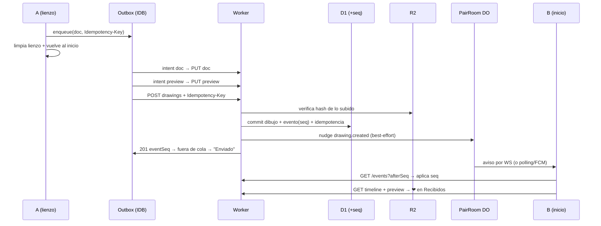

# Cookie — Reporte de flujo completo (Usuario A ↔ Usuario B)

De punta a punta: desde que abren la app hasta que intercambian dibujos,
qué ve cada usuario y qué sucede por detrás en cada paso.
Fuente: código actual del repo (`apps/web`, `packages/*`, `server/*`).

---

## 0. La app en una frase

Cookie es **dibujo compartido para dos**: una sala (`PairSpace`, máx. 2 miembros),
cada uno dibuja en su lienzo y **envía** el dibujo; el otro lo **recibe** en su
historial. El que envía **no** ve lo enviado (el historial es solo de recibidos).

Piezas:

| Capa | Qué hace |
|---|---|
| `apps/web` | Única UI (React+Vite). Habla solo con el Worker por HTTP/WS |
| Worker (`server/api`) | Delgado: valida → caso de uso (`@cookie/core`) → D1/R2 |
| D1 | Verdad: usuarios, instalaciones, sala, miembros, invites, dibujos, eventos con `seq`, idempotencia |
| R2 | Bytes: documento del dibujo + preview (keys generadas por el servidor) |
| PairRoom DO | Solo fanout realtime (nudge). La verdad viaja por `/events` con cursor |
| Outbox local (IndexedDB) | Cola durable de envíos con reintentos y backoff |
| FCM + widget (Android) | Aviso best-effort con app cerrada; refresco instantáneo con app abierta |

Reglas que nunca se rompen: ACK solo tras commit en D1 · WS es aviso, no verdad ·
replay por `seq` (snapshot si el cursor expiró) · dibujo publicado = inmutable
(borrar = tombstone) · mutaciones con `Idempotency-Key` (misma key + mismo
contenido = mismo resultado) · secretos siempre hasheados (PBKDF2 100k),
nunca en logs/SQL/WS.

---

## 1. Abrir la app (ambos usuarios, igual)

1. `main.tsx`: instala el reportero global de errores y monta `<App/>`.
2. Puente nativo + deep links (`cookie://drawing/{id}` → abre el detalle en
   Historial; en navegador no hace nada).
3. Restaurar sesión:
   - Web: `sessionStorage` (vive lo que la pestaña).
   - Android: la WebView olvida el `sessionStorage` al cerrar, así que se
     restaura el espejo guardado en Preferences nativo. Por eso se sigue en
     la misma sala sin crear otra.
4. `GET /v1/me` decide la pantalla:
   - Sin sesión → **Onboarding** (elegir nombre o volver a una sala).
   - Con sesión sin sala → **Setup** (crear o unirse).
   - Con sesión y sala → **Estudio** (inicio = Recibidos).
5. Sesión: bearer corto en memoria; ante un 401 se rota con el refresh
   automáticamente (y el espejo nativo rota también, si no el worker
   fallaría tras la primera rotación).

---

## 2. ACTO 1 — A crea su identidad y su sala

**Lo que ve A:**

1. Portada Cookie → Comenzar → Bienvenido → `Hola, ¿cómo te llamas?`
2. Escribe su nombre (1–32 caracteres, es lo que B verá) → **Entrar**.
3. `Tu espacio compartido` → **Crear espacio y mostrar QR** → crea su
   contraseña (mín. 8 caracteres, es su llave de recuperación) → **Generar QR
   y token**.
4. Pantalla `Espacio listo`: QR grande + **código de la sala** (9 caracteres
   legibles, sin 0/O/1/I para dictarlo) + Compartir + `Ya la compartí, entrar`.

**Lo que pasa por detrás:**

- `POST /v1/installations {platform, displayName}` → crea Usuario +
  Instalación (el secreto queda hasheado; el claro se devuelve UNA vez) +
  sesión (access + refresh). Un usuario = una identidad; un usuario = una sala.
- `POST /v1/pair-spaces {recoverySecret?}` → crea sala `active` + membresía
  `owner` + credencial de recuperación (hash). Devuelve el secreto UNA vez:
  sin él no hay recuperación.
- `POST /v1/pair-spaces/{id}/invites {}` → crea el código. Es **permanente**:
  no caduca, no se quema al usarse, cualquier código de la sala vale para
  siempre (unirse o recuperar).
- A entra al estudio (con barrido de salida). Al entrar: se fija el espacio
  de sync, se sube el token FCM si el nativo ya lo guardó, arranca el motor
  de outbox + realtime, se reconcilian eventos por si llegaron dibujos con la
  app cerrada y (solo Android) se chequea actualización propia una vez.

---

## 3. ACTO 2 — B se une a la sala de A

**Lo que ve B:**

1. Mismo inicio: nombre → **Entrar** → en Setup, en vez de crear, escribe el
   código que A le dictó (o pulsa el escáner y apunta al QR de A) → **Unirse**.
2. Entra directo a la misma sala. Listo: ya son 2/2.

**Lo que pasa por detrás:**

- B ya se registró (`POST /v1/installations`), así que unirse es solo
  vincular: `POST /v1/invites/consume {inviteToken}` (acepta minúsculas).
- El servidor: código válido → sala activa → B existe → si B ya es miembro,
  idempotente (devuelve la sala sin hacer nada) → si B ya tiene otra sala,
  `VALIDATION_ERROR` → si la sala está llena (2/2), `PAIRSPACE_FULL` →
  si no, crea la membresía `member`. El código **no** se consume.
- El QR de invitación (`cookie://invite/{token}`) es solo el token en otro
  formato: escanear = rellenar + unirse.

---

## 4. ACTO 3 — Simulación: A le envía un corazón a B ❤

> B está en su inicio (Recibidos). A abre el lienzo y dibuja un corazón.

### 4.1 A dibuja (todo local)

- Lienzo 1024×1024, herramientas Mover/Pintar, pinceles, undo/redo,
  zoom por pellizco. Cada trazo vive en el motor en memoria.
- Autoguardado **silencioso** a IndexedDB (borrador `local`, con debounce):
  si se cierra la app a mitad, al volver sigue el dibujo. No se muestra
  como algo aparte: es solo red de seguridad.
- **Salir** (modal `¿Seguro de salir?` → `Sí, salir`) vuelve al inicio
  conservando el dibujo. **Enviar** es el único camino de salida con envío.

### 4.2 A pulsa Enviar — minuto a minuto

1. Si el lienzo está vacío: `Dibuja algo primero` y no pasa nada.
2. El documento se serializa y se **encola** en el outbox local con un
   `mutationId` (= `drawingId`) que viaja como `Idempotency-Key`: aunque se
   reintente 10 veces, en el servidor nace UN dibujo.
3. Sin borrador aparte: el dibujo ya vive en el outbox → se **limpia el
   lienzo, se borra el borrador y se vuelve al inicio**. El envío sigue en
   segundo plano.
4. `pump()` procesa la cola, en este orden por dibujo:
   1. SHA-256 del documento → `POST /v1/uploads/intents` (doc) → `PUT`
      del JSON al R2.
   2. Render de preview (webp, presupuesto 16 KB) → SHA-256 → intent →
      `PUT` del preview al R2.
   3. `POST /v1/pair-spaces/{id}/drawings` (drawingId, hash, tamaño) con
      `Idempotency-Key`.
5. **Servidor (una sola transacción lógica):** verifica que los bytes
   subidos cuadran con el hash → commit en D1 (dibujo + evento con `seq`
   siguiente + registro de idempotencia) → fanout best-effort al PairRoom
   (`drawing.created`) → `201 {drawing, eventSeq}`. Si el `seq` choca por
   carrera, reintenta con el registro de idempotencia (misma key + mismo
   contenido = misma respuesta; distinto contenido = `409`).
6. Cliente: fuera del outbox → **un solo aviso**: `Enviado` ✅. Si quedó en
   cola (sin red): `En cola para publicar`, y se envía solo al volver la
   red (pump cada 10 s + al evento `online`, backoff 1 s…30 s con jitter;
   lo no-reintentable pasa a fallido con botón Reintentar en el inicio).

### 4.3 B lo recibe (sin tocar nada)

- Camino rápido (app abierta): el WS avisa → B reconcilia por cursor →
  el historial se refresca + toast `Nuevo dibujo recibido` (+ widget
  Android al instante).
- Camino lento: polling cada 15 s, o FCM data-only `{spaceId, seq}` con app
  cerrada (best-effort: Doze/OEM pueden demorarlo; al abrir, reconcilia y
  converge igual).
- B ve en **Recibidos**: la tarjeta del corazón + fecha, el `Espacio
  b770b050…` con botón copiar, y al abrirla: borrar (tombstone, no borra el
  original publicado) o descargarla. **Lo que B envía no aparece en su
  historial**: cada uno solo ve lo que le llega.

---

## 5. ACTO 4 — B responde (simétrico)

B → **Dibujar** → trazo → **Enviar** → mismo pipeline del §4 → A lo recibe
en su inicio. El protocolo no distingue A de B: owner y member publican
igual (límite 60 publicaciones/min por instalación).

---

## 6. Segundo dispositivo / volver a entrar (los dos caminos)

Si A pierde la sesión (navegador nuevo, app reinstalada) y pulsa
`Ya tengo una sala` → `Vuelve a tu sala`:

**Opción A — QR aprobado (estilo WhatsApp Web, sin escribir nada):**

1. Este teléfono genera un intento y muestra su **QR de entrada**
   (válido ~5 min, un solo uso).
2. En el otro teléfono, dentro de la sala: **Escanear QR** → apunta aquí.
3. Escanear = aprobar → este teléfono sondea cada 2,5 s (`Esperando
   aprobación…`) → entra con su **misma identidad y misma sala**, sin crear
   otra, sin duplicar miembros.

**Opción B — código + contraseña:**

1. Escribe el **código de la sala** (cualquiera vale, no caduca) + su
   **contraseña** exacta de creación → **Recuperar**.
2. Por detrás: challenge por código (respuesta indistinguible para no filtrar
   qué existe; 10 min de vida) → verifica PBKDF2 → si la sala está llena de
   accesos activos exige el código (prueba de que un miembro autorizó) y ata
   la instalación nueva al miembro correspondiente → deja sesión y entra
   directo a la misma sala.
3. Límite 10 intentos/min: si se abusa, `Demasiados intentos. Espera un
   minuto y reintenta.`

---

## 7. Salir, abandonar y offline

| Acción | Qué hace |
|---|---|
| Salir del lienzo (modal) | Vuelve al inicio, dibujo conservado en borrador silencioso |
| Enviar | Encola durable → limpia lienzo y borrador → inicio → envía en 2.º plano |
| `N por enviar…` + Reintentar | Cola visible en el inicio cuando hay pendientes/fallidos |
| Abandonar sala (escribir `salir`) | Cierra sesión local (revoca en servidor best-effort) → onboarding. La membresía en servidor queda |
| Sin red | Todo se encola; nada se pierde: outbox + borrador persisten hasta confirmación del backend |

---

## 8. Límites y errores que el usuario puede ver

- `Dibuja algo primero` (enviar vacío) · `No se pudo encolar` (fallo local
  grave) · `En cola para publicar` / `Enviado` (un solo aviso según resultado)
- `Nuevo dibujo recibido` · `QR no reconocido` · `Demasiados intentos…`
- Rate limits/min: crear invitación 10 · consumir 20 · intentos QR 20/20/60 ·
  recuperación 10 · publicar 60 · uploads 120 · tickets realtime 60.
- Realtime: ticket de un solo uso de segundos por WS; protos `?ticket=`,
  `hello{lastEventSeq}` → `ready`; si el cursor expiró, snapshot y a seguir.
- Tamaños: preview ≤ 16 KB · documento recuperable ≤ 512 KB · timeline 20/pág.

---

*Fin del reporte. Flujo verificado contra el código el 2026-10-13.*
